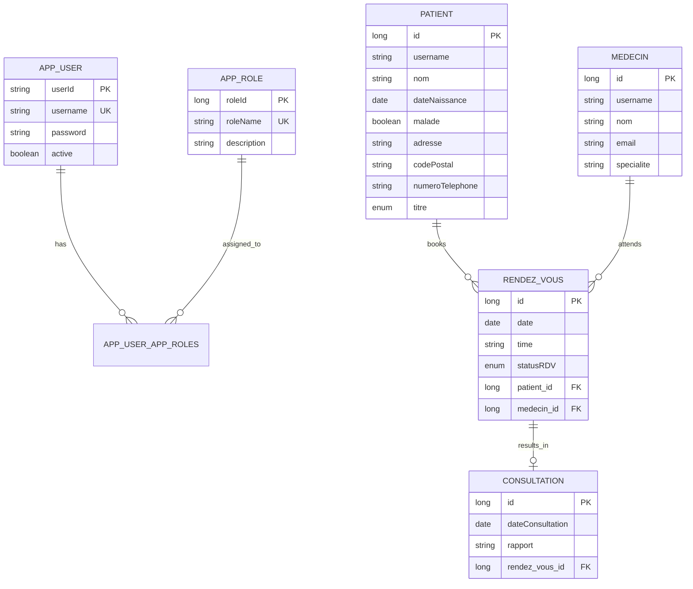

<](https://spring.io/projects/spring-boot)
[](https://angular.io/)
[](https://www.mysql.com/)
[](https://docs.docker.com/compose/)
[](https://openjdk.org/)
[](LICENSE)

</div>

---

## 📋 Table of Contents

- [Overview](#-overview)
- [Architecture](#-architecture)
- [Features](#-features)
- [Tech Stack](#-tech-stack)
- [Project Structure](#-project-structure)
- [Getting Started](#-getting-started)
- [API Reference](#-api-reference)
- [Role-Based Access Control](#-role-based-access-control)
- [Default Accounts](#-default-accounts)
- [Database Schema](#-database-schema)
- [Screenshots](#-screenshots)
- [Contributing](#-contributing)

---

## 🔍 Overview

**Dar Ettabib** (دار الطبيب — "The Doctor's House") is a comprehensive hospital management system designed to streamline the daily operations of a medical facility. It provides distinct interfaces for **Administrators**, **Doctors**, and **Patients**, each with tailored dashboards, permissions, and workflows.

The platform handles the full lifecycle of hospital interactions — from patient registration and doctor onboarding, through appointment scheduling with intelligent conflict detection, to consultation record management.

---

## 🏗 Architecture

```
┌─────────────────────┐     REST API (JSON)     ┌──────────────────────┐
│   Angular 17 SPA    │ ◄──────────────────────► │  Spring Boot 2.6.6   │
│   (Port 4200)       │      HTTP / CORS         │  (Port 8086)         │
│                     │                          │                      │
│  • Standalone       │                          │  • JPA / Hibernate   │
│  • Bootstrap 5      │                          │  • Spring Security   │
│  • Reactive Forms   │                          │  • Bean Validation   │
└─────────────────────┘                          └──────────┬───────────┘
                                                            │
                                                   JDBC (3306)
                                                            │
                                                 ┌──────────▼───────────┐
                                                 │      MySQL 8.0      │
                                                 │   Database: PATIENT  │
                                                 └──────────────────────┘
```

All three services are orchestrated via **Docker Compose** for one-command deployment.

---

## ✨ Features

### 🔐 Authentication & Authorization

| Feature | Description |
|---|---|
| **Login System** | Session-based authentication with BCrypt password hashing |
| **User Registration** | Separate signup flows for Patients and Doctors |
| **Role-Based Access** | Three roles — `ADMIN`, `DOCTOR`, `PATIENT` — with distinct permissions |
| **Route Guards** | Angular `canActivate` guards protect all authenticated routes |
| **Auto-redirect** | Logged-in users are redirected away from login/signup pages |
| **Demo Accounts** | One-click demo account cards on the login page for quick testing |

### 👨‍⚕️ Patient Management

| Feature | Description |
|---|---|
| **CRUD Operations** | Create, read, update, and delete patient records |
| **Search & Filter** | Server-side keyword search by patient name |
| **Pagination** | Configurable page sizes with navigation controls |
| **Rich Profiles** | Name, title (Mr/Mme), date of birth, address, postal code, phone number, health status |
| **Health Indicator** | Visual badge showing if a patient is currently sick |
| **Doctor-Scoped View** | Doctors see only their own patients (those with appointments) |
| **Form Validation** | Client-side and server-side validation (name: 3–50 chars, required fields) |

### 🩺 Doctor (Médecin) Management

| Feature | Description |
|---|---|
| **CRUD Operations** | Full management of doctor records (Admin only) |
| **Search & Filter** | Server-side keyword search by doctor name |
| **Pagination** | Paginated doctor listing with navigation |
| **Doctor Profiles** | Name, email, specialty, username linkage |
| **Username Binding** | Each doctor account is linked to an `AppUser` for authentication |

### 📅 Appointment (Rendez-vous) Management

| Feature | Description |
|---|---|
| **Scheduling** | Book appointments with date, time, patient, and doctor selection |
| **Status Tracking** | Three-state lifecycle: `PENDING` → `DONE` / `CANCELED` |
| **Conflict Detection** | Server-side validation prevents booking within 15 minutes of an existing appointment for the same doctor |
| **Role-Aware Views** | Admins see all; Doctors see their appointments; Patients see their own |
| **Auto-Fill** | Patient and Doctor IDs are pre-filled based on the logged-in user's role |
| **Date Validation** | Frontend restricts appointment dates to today or future |
| **Color-Coded Status** | Visual badges — green (Done), yellow (Pending), red (Canceled) |

### 📝 Consultation Management

| Feature | Description |
|---|---|
| **CRUD Operations** | Create, read, update, and delete consultation records |
| **Linked to Appointments** | Each consultation is associated with a Rendez-vous (1:1 relationship) |
| **Medical Reports** | Free-text rapport field for clinical notes |
| **Pagination** | Paginated consultation listing |

### 📊 Dashboard

| Feature | Description |
|---|---|
| **Role-Adaptive** | Different dashboard layouts per role |
| **Admin Dashboard** | 4 stat cards — Total Patients, Doctors, Appointments, Consultations |
| **Doctor Dashboard** | 3 stat cards — Patients, Appointments, Consultations |
| **Patient Dashboard** | 2 stat cards — My Appointments, My Consultations |
| **Quick Navigation** | Each stat card links to its detail page |
| **Welcome Section** | Role-specific guidance text |

### 🎨 UI/UX

| Feature | Description |
|---|---|
| **Sidebar Navigation** | Fixed sidebar with role-filtered menu items |
| **Role Badges** | Color-coded labels: Admin (blue), Doctor (green), Patient (cyan) |
| **Responsive Design** | Bootstrap 5 grid system for mobile/desktop |
| **Bootstrap Icons** | Consistent iconography across the application |
| **Modal Dialogs** | CSS-driven modals for all create/edit forms (no Bootstrap JS required) |
| **Fade-in Animations** | Smooth route transition effects |
| **Split Login Screen** | Two-panel login with branding and feature highlights |

---

## 🛠 Tech Stack

### Backend

| Technology | Version | Purpose |
|---|---|---|
| **Spring Boot** | 2.6.6 | Application framework |
| **Spring Data JPA** | — | ORM & data access layer |
| **Spring Security** | — | Authentication & CORS |
| **Hibernate** | — | JPA provider with MySQL dialect |
| **Bean Validation** | — | Request body validation (`@NotEmpty`, `@Size`) |
| **Lombok** | — | Boilerplate reduction (`@Data`, `@AllArgsConstructor`) |
| **MySQL Connector** | — | Database driver |
| **Maven** | 3.8.7 | Build tool |
| **Java** | 8 (Temurin) | Runtime |

### Frontend

| Technology | Version | Purpose |
|---|---|---|
| **Angular** | 17.3 | SPA framework (standalone components) |
| **Bootstrap** | 5.3 | CSS framework |
| **Bootstrap Icons** | 1.13 | Icon library |
| **RxJS** | 7.8 | Reactive HTTP client |
| **TypeScript** | — | Type-safe development |

### Infrastructure

| Technology | Purpose |
|---|---|
| **Docker Compose** | Multi-container orchestration |
| **MySQL 8.0** | Relational database |
| **Maven Wrapper** | Reproducible backend builds |

---


## 🚀 Getting Started

### Prerequisites

- **Docker** & **Docker Compose** installed
- **Git** for cloning the repository

### Quick Start (Docker)

```bash
# 1. Clone the repository
git clone git@github.com:ahmad-bensalah/Dar-Ettabib.git
cd Dar-Ettabib

# 2. Start all services
docker compose up -d

# 3. Wait ~30 seconds for the backend to compile and start

# 4. Open the application
#    Frontend:  http://localhost:4200
#    Backend:   http://localhost:8086
#    MySQL:     localhost:3302
```

### Manual Setup

#### Backend

```bash
cd Hospital-Management-Spring-Boot

# Configure database in src/main/resources/application.properties
# Default: MySQL on localhost:3302, database PATIENT

./mvnw spring-boot:run
```

#### Frontend

```bash
cd hospital-frontend
npm install
ng serve --host 0.0.0.0 --port 4200
```

### Docker Services

| Service | Image | Port | Description |
|---|---|---|---|
| `db` | `mysql:8.0` | `3302 → 3306` | MySQL database with health checks |
| `backend` | `maven:3.8.7-eclipse-temurin-8` | `8086 → 8086` | Spring Boot API (compiled on startup) |
| `frontend` | `node:20` | `4200 → 4200` | Angular dev server with hot-reload |

---

## 📡 API Reference

### Authentication

| Method | Endpoint | Description | Body |
|---|---|---|---|
| `POST` | `/api/auth/login` | Authenticate user | `{ username, password }` |
| `POST` | `/api/auth/signup/patient` | Register as patient | `SignupDto` |
| `POST` | `/api/auth/signup/doctor` | Register as doctor | `SignupDto` |

### Patients

| Method | Endpoint | Description | Params |
|---|---|---|---|
| `GET` | `/api/patients` | List patients (paginated) | `page`, `size`, `keyword` |
| `GET` | `/api/patients/{id}` | Get patient by ID | — |
| `GET` | `/api/patients/by-username/{username}` | Get patient by username | — |
| `GET` | `/api/patients/doctor/{username}` | Get patients for a doctor | `page`, `size`, `keyword` |
| `POST` | `/api/patients` | Create patient | `Patient` body |
| `PUT` | `/api/patients/{id}` | Update patient | `Patient` body |
| `DELETE` | `/api/patients/{id}` | Delete patient | — |

### Doctors (Médecins)

| Method | Endpoint | Description | Params |
|---|---|---|---|
| `GET` | `/api/medecins` | List doctors (paginated) | `page`, `size`, `keyword` |
| `GET` | `/api/medecins/all` | List all doctors (no pagination) | — |
| `GET` | `/api/medecins/{id}` | Get doctor by ID | — |
| `GET` | `/api/medecins/by-username/{username}` | Get doctor by username | — |
| `POST` | `/api/medecins` | Create doctor | `Medecin` body |
| `PUT` | `/api/medecins/{id}` | Update doctor | `Medecin` body |
| `DELETE` | `/api/medecins/{id}` | Delete doctor | — |

### Rendez-vous (Appointments)

| Method | Endpoint | Description | Params |
|---|---|---|---|
| `GET` | `/api/rendezvous` | List appointments (paginated) | `page`, `size` |
| `GET` | `/api/rendezvous/{id}` | Get appointment by ID | — |
| `GET` | `/api/rendezvous/patient/{username}` | Get appointments for a patient | — |
| `GET` | `/api/rendezvous/doctor/{username}` | Get appointments for a doctor | — |
| `POST` | `/api/rendezvous` | Create appointment (with conflict check) | `RendezVous` body |
| `PUT` | `/api/rendezvous/{id}` | Update appointment | `RendezVous` body |
| `DELETE` | `/api/rendezvous/{id}` | Delete appointment | — |

> ⚠️ **Conflict Detection**: Creating or updating an appointment will return `400 Bad Request` if the doctor already has an appointment within 15 minutes of the requested time on the same day.

### Consultations

| Method | Endpoint | Description | Params |
|---|---|---|---|
| `GET` | `/api/consultations` | List consultations (paginated) | `page`, `size` |
| `GET` | `/api/consultations/{id}` | Get consultation by ID | — |
| `POST` | `/api/consultations` | Create consultation | `Consultation` body |
| `PUT` | `/api/consultations/{id}` | Update consultation | `Consultation` body |
| `DELETE` | `/api/consultations/{id}` | Delete consultation | — |

---

## 🔒 Role-Based Access Control

### Menu Visibility

| Page | ADMIN | DOCTOR | PATIENT |
|---|:---:|:---:|:---:|
| Dashboard | ✅ | ✅ | ✅ |
| Patients | ✅ | ✅ (own patients only) | ❌ |
| Médecins | ✅ | ❌ | ❌ |
| Consultations | ✅ | ✅ | ✅ |
| Rendez-vous | ✅ | ✅ (own only) | ✅ (own only) |

### Data Scope per Role

| Role | Patients | Appointments | Consultations | Doctors |
|---|---|---|---|---|
| **ADMIN** | All patients | All appointments | All records | Full CRUD |
| **DOCTOR** | Only assigned patients | Own appointments | All records | Read-only (own profile) |
| **PATIENT** | N/A | Own appointments | All records | Browse for booking |

---

## 🔑 Default Accounts

The application automatically seeds the following accounts on first startup:

| Role | Username | Password |
|---|---|---|
| 🛡️ Administrator | `admin` | `admin123` |
| 🩺 Doctor | `doctor` | `doctor123` |
| 🧑 Patient | `patient` | `patient123` |

> 💡 These can be clicked directly on the login screen for quick access.

---

## 🗄 Database Schema



---

## 🖼 Screenshots

> _Run the application with `docker compose up -d` and visit `http://localhost:4200` to see the UI in action._

### Login Page
Split-screen design with branding panel, demo account quick-select cards, and a clean sign-in form.

### Dashboard  
Role-adaptive stat cards with live counts — patients, doctors, appointments, and consultations.

### Patient Management  
Searchable, paginated table with inline edit/delete actions and a modal form for creating new patients.

### Appointment Scheduling  
Full appointment lifecycle with doctor/patient selection, time picker, status tracking, and 15-minute conflict prevention.

---

## 🤝 Contributing

1. Fork the repository
2. Create your feature branch (`git checkout -b feature/amazing-feature`)
3. Commit your changes (`git commit -m 'feat: add amazing feature'`)
4. Push to the branch (`git push origin feature/amazing-feature`)
5. Open a Pull Request

---

<div align="center">

**Built with ❤️ using Spring Boot & Angular**

*Dar Ettabib — Making hospital management simple and efficient.*

</div>
]]>
