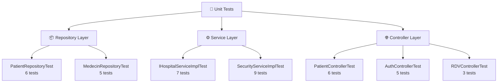

# Unit Testing Walkthrough — Dar Ettabib

## What Was Created

A comprehensive **3-layer test suite** with **7 test classes** and **~40 test cases** covering the entire Spring Boot backend.

---

## Test Architecture Overview



---


### 1️⃣ Repository Layer — `@DataJpaTest`

**Files:** [PatientRepositoryTest.java](file:///home/abid/Documents/Dar-Ettabib/Hospital-Management-Spring-Boot/src/test/java/ma/fss/repositories/PatientRepositoryTest.java), 
[MedecinRepositoryTest.java](file:///home/abid/Documents/Dar-Ettabib/Hospital-Management-Spring-Boot/src/test/java/ma/fss/repositories/MedecinRepositoryTest.java)

**What to say:**
> "We use `@DataJpaTest` which auto-configures an **H2 in-memory database** so we don't need MySQL for testing. This annotation only loads the JPA layer — repositories and entities — making tests fast and isolated."

**Key points to highlight:**
- **H2 replaces MySQL** — tests run without any external database
- **`@BeforeEach`** — seeds fresh test data before each test (isolation)
- Tests verify: `findByUsername`, `findByNomContains` (search), pagination, save, delete
- Shows that **custom JPQL queries work correctly** (like the doctor-scoped patient query)

**Example test to walk through:**
```java
@Test
void shouldFindByNomContains() {
    Page<Patient> result = patientRepository.findByNomContains("Ahmed", PageRequest.of(0, 10));
    assertThat(result.getContent()).hasSize(1);  // Only 1 match
}
```
> "This test verifies our search feature — when a user searches for 'Ahmed', only matching patients are returned. The `PageRequest` parameter ensures pagination works correctly."

---

### 2️⃣ Service Layer — `@ExtendWith(MockitoExtension.class)`

**Files:** [IHospitalServiceImplTest.java](file:///home/abid/Documents/Dar-Ettabib/Hospital-Management-Spring-Boot/src/test/java/ma/fss/service/IHospitalServiceImplTest.java), [SecurityServiceImplTest.java](file:///home/abid/Documents/Dar-Ettabib/Hospital-Management-Spring-Boot/src/test/java/ma/fss/security/service/SecurityServiceImplTest.java)

**What to say:**
> "For the service layer, we use **Mockito** to mock the repository dependencies. This lets us test the business logic in isolation without touching the database. We use `@Mock` for dependencies and `@InjectMocks` for the class under test."

**Key points to highlight:**
- **No Spring context needed** — pure Java tests (fastest execution)
- **`@Mock`** creates fake repository objects
- **`@InjectMocks`** injects the mocks into the service
- **`when().thenReturn()`** — defines mock behavior
- **`verify()`** — asserts that methods were called
- Tests **error cases** (RuntimeException when no patient/doctor exists)

**Example test to walk through:**
```java
@Test
void shouldThrowExceptionWhenNoPatientExists() {
    RendezVous rdv = new RendezVous();
    rdv.setPatient(null);
    when(patientRepository.findAll()).thenReturn(Collections.emptyList());

    assertThatThrownBy(() -> hospitalService.saveRendezVous(rdv))
        .isInstanceOf(RuntimeException.class)
        .hasMessageContaining("patient");
}
```
> "This test verifies a defensive behavior — if someone tries to create an appointment without a patient and no patients exist in the database, the system throws an appropriate error message instead of crashing."

**SecurityServiceImplTest highlights:**
- Tests **password hashing** with BCrypt
- Tests **password mismatch rejection**
- Tests **role assignment and removal**
- Tests **duplicate role prevention**

---

### 3️⃣ Controller Layer — `@WebMvcTest`

**Files:** [PatientControllerTest.java](file:///home/abid/Documents/Dar-Ettabib/Hospital-Management-Spring-Boot/src/test/java/ma/fss/web/PatientControllerTest.java), [AuthControllerTest.java](file:///home/abid/Documents/Dar-Ettabib/Hospital-Management-Spring-Boot/src/test/java/ma/fss/web/AuthControllerTest.java), [RDVControllerTest.java](file:///home/abid/Documents/Dar-Ettabib/Hospital-Management-Spring-Boot/src/test/java/ma/fss/web/RDVControllerTest.java)

**What to say:**
> "Controller tests use `@WebMvcTest` which loads only the web layer — the controller and security configuration. We use `MockMvc` to simulate HTTP requests and verify response status codes, JSON body content, and headers. No server actually starts."

**Key points to highlight:**
- **`MockMvc`** — simulates HTTP requests (GET, POST, PUT, DELETE)
- **`@MockBean`** — mocks the repositories/services that controllers depend on
- Tests verify: **HTTP status codes** (200, 201, 404, 401), **JSON response** structure
- Uses `jsonPath()` for **precise JSON assertions**

**Example test to walk through (AuthController):**
```java
@Test
void shouldRejectInvalidPassword() throws Exception {
    when(securityService.loadUserByUsername("admin")).thenReturn(user);
    when(passwordEncoder.matches("wrong", hashedPwd)).thenReturn(false);

    mockMvc.perform(post("/api/auth/login")
            .contentType(MediaType.APPLICATION_JSON)
            .content("{\"username\":\"admin\",\"password\":\"wrong\"}"))
        .andExpect(status().isUnauthorized())
        .andExpect(jsonPath("$.error", containsString("Invalid")));
}
```
> "This test simulates a POST request to the login endpoint with a wrong password. We verify the server returns HTTP 401 (Unauthorized) and an error message containing 'Invalid'."

**RDV conflict detection (the most impressive test):**
> "This test verifies our 15-minute scheduling conflict rule. We create an existing appointment at 10:00, then try to book another at 10:10 for the same doctor. The system correctly rejects it with HTTP 400."

---

## How to Run the Tests

```bash
# Run all tests
cd Hospital-Management-Spring-Boot
./mvnw test

# Run a specific test class
./mvnw test -Dtest=PatientRepositoryTest

# Run with verbose output
./mvnw test -Dtest=AuthControllerTest -Dsurefire.useFile=false
```

---

## Presentation Script for the Professor

### Step 1: Show the test structure
> "Our test suite follows a **3-layer architecture** that mirrors our application:"
> - **Repository tests** → verify database queries
> - **Service tests** → verify business logic
> - **Controller tests** → verify REST API behavior

### Step 2: Run the tests live
```bash
./mvnw test
```
> Show the green test output with all tests passing.

### Step 3: Explain the key testing patterns

| Pattern | Annotation | What It Does |
|---|---|---|
| **Integration test** | `@DataJpaTest` | Tests JPA repos with real H2 database |
| **Unit test** | `@ExtendWith(MockitoExtension.class)` | Tests logic with mocked dependencies |
| **Web test** | `@WebMvcTest` | Tests HTTP endpoints with MockMvc |

### Step 4: Highlight the business-critical test
> "Our most important test verifies the **scheduling conflict detection** — a doctor can't have two appointments within 15 minutes. This prevents double-booking."

### Step 5: Show test isolation
> "Each test is independent. `@BeforeEach` resets the data, and Mockito stubs are fresh per test. This means tests can run in any order."

---

## Summary

Test Class	                Tests	Status
PatientApplicationTests 	1	    ✅
PatientRepositoryTest	    7	    ✅
MedecinRepositoryTest	    5	    ✅
IHospitalServiceImplTest	7	    ✅
SecurityServiceImplTest	    10	    ✅
PatientControllerTest	    7	    ✅
AuthControllerTest	        6	    ✅
RDVControllerTest	        3	    ✅
Total	                    47	    ✅ ALL PASS

docker run --rm -v "$(pwd)/Hospital-Management-Spring-Boot:/workspace/backend" -v maven_cache:/root/.m2 -w /workspace/backend maven:3.8.7-eclipse-temurin-8 mvn test 2>&1 | tail -40

docker run --rm -v "$(pwd)/Hospital-Management-Spring-Boot:/workspace/backend" \
  -v maven_cache:/root/.m2 -w /workspace/backend \
  maven:3.8.7-eclipse-temurin-8 mvn test

tory shut-down'
Hibernate: drop table if exists consultation CASCADE 
Hibernate: drop table if exists medecin CASCADE 
Hibernate: drop table if exists patient CASCADE 
Hibernate: drop table if exists rendez_vous CASCADE 
[INFO] 
[INFO] Results:
[INFO] 
[INFO] Tests run: 47, Failures: 0, Errors: 0, Skipped: 0
[INFO] 
[INFO] ------------------------------------------------------------------------
[INFO] BUILD SUCCESS
[INFO] ------------------------------------------------------------------------
[INFO] Total time:  7.274 s
[INFO] Finished at: 2026-05-08T00:33:53Z
[INFO] ------------------------------------------------------------------------